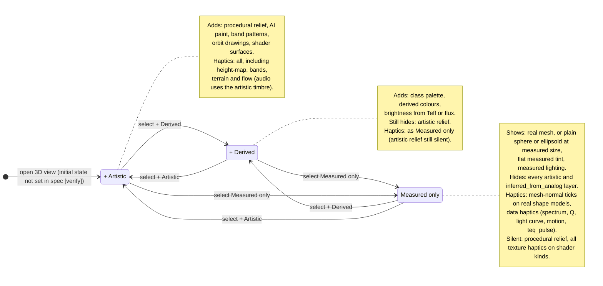

# 14 State: honesty toggle

The three-state honesty toggle in the 3D view, what each state shows and which haptics stay active. Drawn from rendering doc §5.3, §7.7, §8.2, §9, §11 (honesty test) and decisions D-02 and D-12.

## Notes

- Every visible layer shows a tag chip in the legend. Each state change is announced through `aria-live="polite"` (rendering doc §9).
- Acceptance test: in Measured only no `artistic` or `inferred_from_analog` layer is drawn and procedural texture haptics are silent (rendering doc §11).
- D-12 keeps the `teq_pulse` (tagged `derived`) in Measured only. Whether other `derived` data haptics stay on in Measured only is not stated explicitly **[verify]**.
