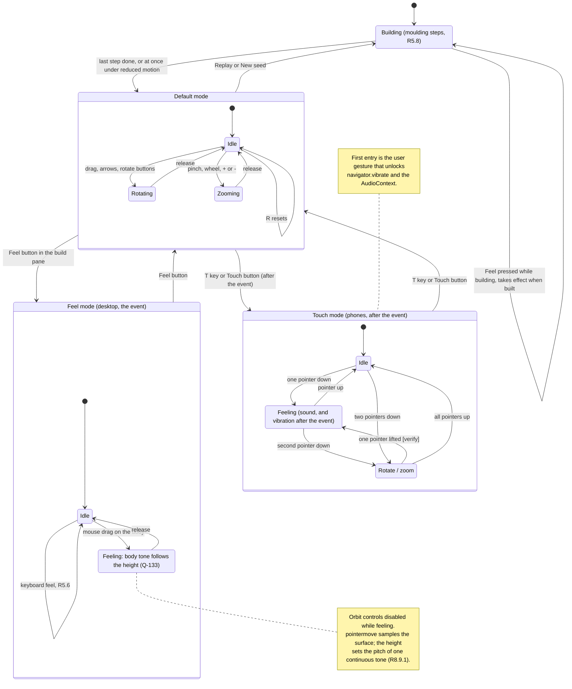
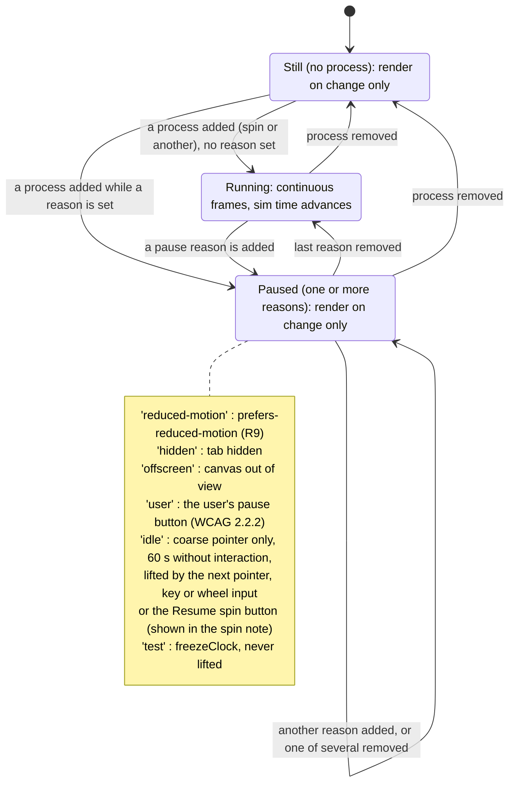

# 15 State: viewer interaction

How pointer, keyboard and the Feel and Touch toggles change what the 3D view does, and when the viewer's sim clock runs. Drawn from rendering doc R5.6, R5.8, R8.4, R8.9.1, R9, R5.7 and decisions D-08, D-10, D-20, D-34, **Q-132** (the event is the A15 laptop: desktop Feel mode, sound only; Touch mode and vibration after the event) and **Q-133** (feeling plays the body tone). The 3D view lives in the build pane of the split pane; the shell states around it are in [24-state-shell.md](24-state-shell.md). Feel mode is specified but **not built yet** (R5.6).

## Sim clock (motion)

The `SimClock` (`frontend/src/viewer/render/clock.ts`) runs only while a process exists (the spin, and since issue #42 the star, jet, storm, cloud and pulsation processes that `resolveMotion` in `motion/motion.ts` states; Q-104). A process is registered only when it drives a drawn layer: `finishMotion` in `motion/planMotion.ts` fills `Motion.activeProcesses` and `ViewerApp` registers only that list, so a still scene does not run the frame loop (Q-108) and no pause reason is set. Each reason is added and removed on its own; the clock runs again only when the set is empty.

## Notes

- Rotate buttons exist on screen in every mode (WCAG 2.5.7 alternative to dragging). All controls are ≥ 24×24 CSS px and keyboard reachable (rendering doc §9).
- `prefers-reduced-motion` disables auto-spin (rendering doc §9): it is the `reduced-motion` pause reason above.
- Whatever pauses the clock, a change (honesty, new plan, rotate, zoom) still renders one settle burst. How the viewer implements motion and quality levels is Q-66 in [decisions](../decisions/README.md).
- Whether a `stop` event is sent on pointer up is not stated **[verify]**.
- On the A15 laptop at the event, and on iPhone, iPad and desktop, feeling produces sound only (Q-132, D-08, D-10). How Feel works from the keyboard and while a build runs: R5.6 and R5.8.
- Feeling works on every kind except the nebula and the nova, which have no haptics (Q-103; it amends the D-12 and D-20 field pulse, Atish's acceptance pending). The 3D view says so in plain words ("Nebulae have no touch feedback"). Each emitted event also fires the `spherex:haptic` debug event, which drives the on-screen pulse indicator ([11-sequence-touch-haptics.md](11-sequence-touch-haptics.md)).
