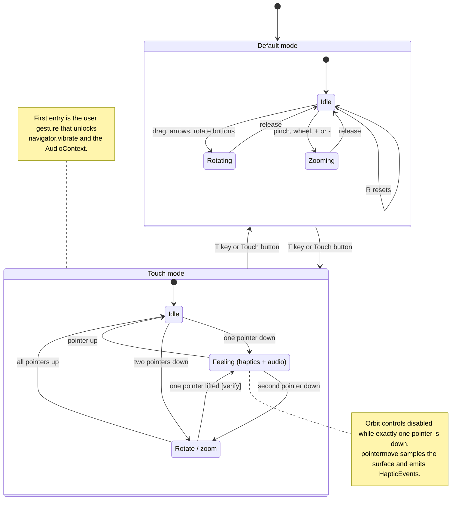

# 15 State: viewer interaction

How pointer, keyboard and the Touch-mode toggle change what the 3D view does. Drawn from rendering doc §5.6, §8.4, §9 and decisions D-08 and D-10.

## Notes

- Rotate buttons exist on screen in both modes (WCAG 2.5.7 alternative to dragging). All controls are ≥ 24×24 CSS px and keyboard reachable (rendering doc §9).
- `prefers-reduced-motion` disables auto-spin (rendering doc §9).
- Whether a `stop` event is sent on pointer up is not stated **[verify]**.
- On iPhone, iPad and desktop, Feeling produces sound only (D-08, D-10).
