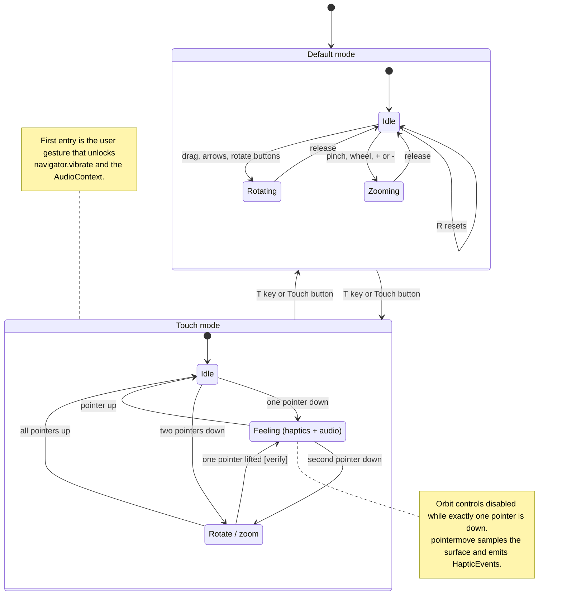
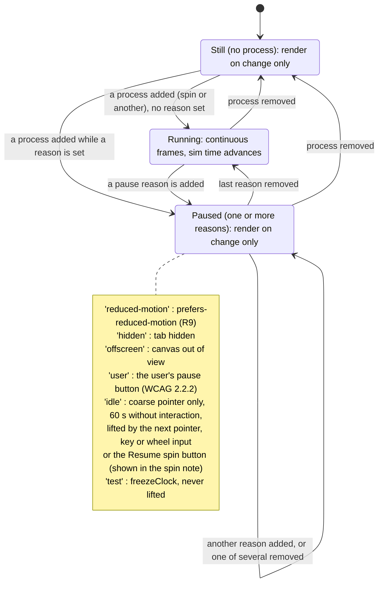

# 15 State: viewer interaction

How pointer, keyboard and the Touch-mode toggle change what the 3D view does, and when the viewer's sim clock runs. Drawn from rendering doc §5.6, §8.4, §9, R5.7 and decisions D-08, D-10, D-20 and D-34.

## Sim clock (motion)

The `SimClock` (`frontend/src/viewer/render/clock.ts`) runs only while a process exists (the spin, and since issue #42 the star, jet, storm, cloud and pulsation processes that `motion/planMotion.ts` states; Q-103) and no pause reason is set. Each reason is added and removed on its own; the clock runs again only when the set is empty.

## Notes

- Rotate buttons exist on screen in both modes (WCAG 2.5.7 alternative to dragging). All controls are ≥ 24×24 CSS px and keyboard reachable (rendering doc §9).
- `prefers-reduced-motion` disables auto-spin (rendering doc §9): it is the `reduced-motion` pause reason above.
- Whatever pauses the clock, a change (honesty, new plan, rotate, zoom) still renders one settle burst. How the viewer implements motion and quality levels is Q-66 in [decisions](../decisions.md).
- Whether a `stop` event is sent on pointer up is not stated **[verify]**.
- On iPhone, iPad and desktop, Feeling produces sound only (D-08, D-10).
- Feeling works on every kind: nebulae and novae get the D-12 field pulse, not a refusal (D-20). Each emitted event also fires the `spherex:haptic` debug event, which drives the on-screen pulse indicator ([11-sequence-touch-haptics.md](11-sequence-touch-haptics.md)).
