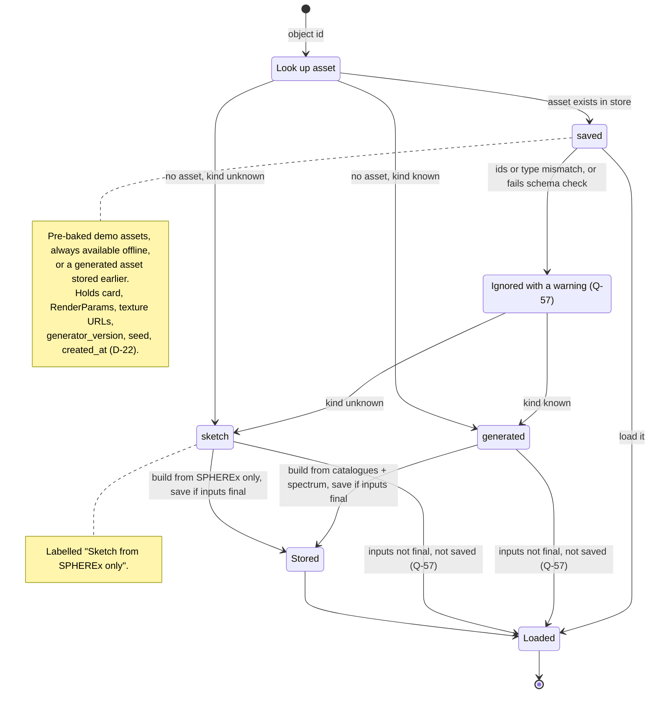
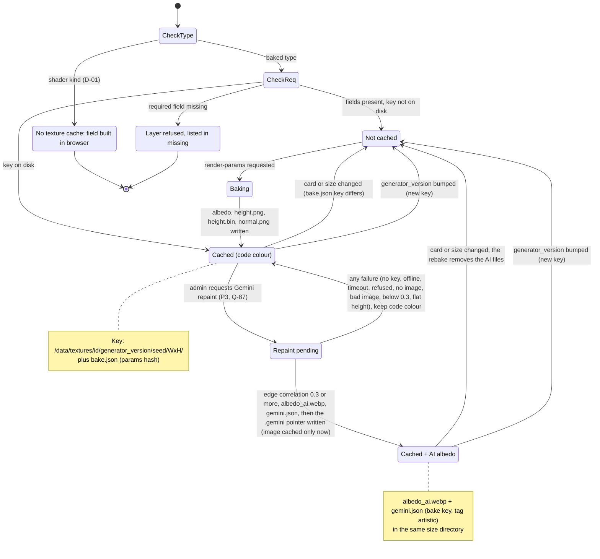

# 16 State: asset lookup and texture cache

Diagram 1 is the asset status from pipeline stage 4 (`saved`, `generated`, `sketch`). Diagram 2 is the life of one backend texture-cache entry. Drawn from architecture spec §4.4, §5.4 and §10, rendering doc §6.6–6.7, §7.7, and decisions D-01, D-02, D-07 and D-22, and the open Q-87 (Gemini layer files).

## Diagram 1: asset status

## Diagram 2: texture cache entry

## Notes

- With D-02 the settings file is retired. A `saved` asset holds the ObjectCard, the RenderParams, the texture URLs, `generator_version`, `seed` and `created_at` (D-22, architecture spec §5.4). `generator_version` and `seed` keep the texture cache key reproducible.
- The architecture spec puts generated assets and the user's `overrides` in browser IndexedDB; `overrides` are never sent to the server (D-22). The backend texture cache is separate, and so is the read-through cache of external calls (D-25).
- Bumping `generator_version` does not delete old entries; it changes the key. Clean-up is not specified.
- Baking failures are not specified **[verify]**.
- As built (issue #14, Q-87): a Gemini repaint never leaves the entry broken. Every failure returns to `Cached` with the code colour, and the reason is in the status body (`albedo_ai` in `missing`). The status endpoint reports `not_painted` for `Cached`, and `stale` when `gemini.json` does not match the current `bake.json`. The backend root is `SX_TEXTURES_DIR` (default `<SX_CACHE_DIR>/textures`).
- As built (issue #5): a `generated` or `sketch` asset is stored only when its inputs are final (a spectrum from a complete frame list, and a catalogue match or typed coordinates); otherwise it is rebuilt on every request (Q-57). The status reaches the client as the `X-SX-Asset-Status` header (Q-39). Pre-baked assets live in `backend/assets/<type>/<id>.json` (`SX_ASSETS_DIR`); generated ones in the D-25 cache as `derived.asset`, keyed by id, data release, `ASSET_VERSION` and `GENERATOR_VERSION`. A saved or pre-baked asset whose card or params id is not the requested id, whose card and params disagree on `type`, or that fails the `jsonschema` check is ignored with a warning and rebuilt from the catalogues, never returned as an error (the Rejected state). This differs from A5.4, which puts generated assets in IndexedDB (Q-57). A saved asset whose card type is `candidate` is reported as `sketch`, not `saved`, so the "Sketch from SPHEREx only" label survives the save; a saved generated asset reports the `fetched_at` of its cache entry as `X-SX-Cached-At` (PR #34 review).
