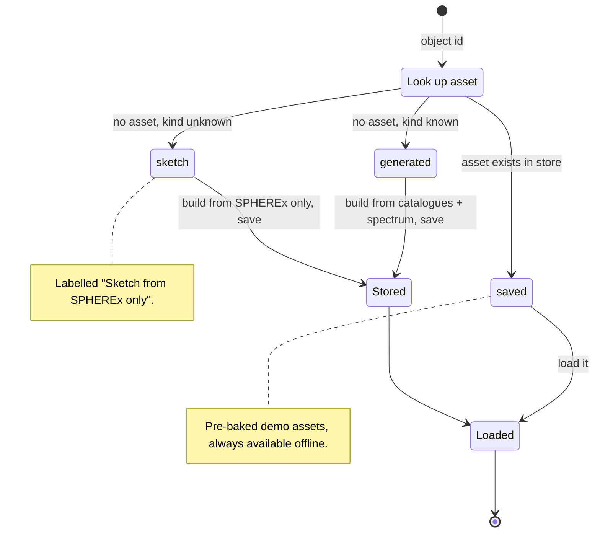
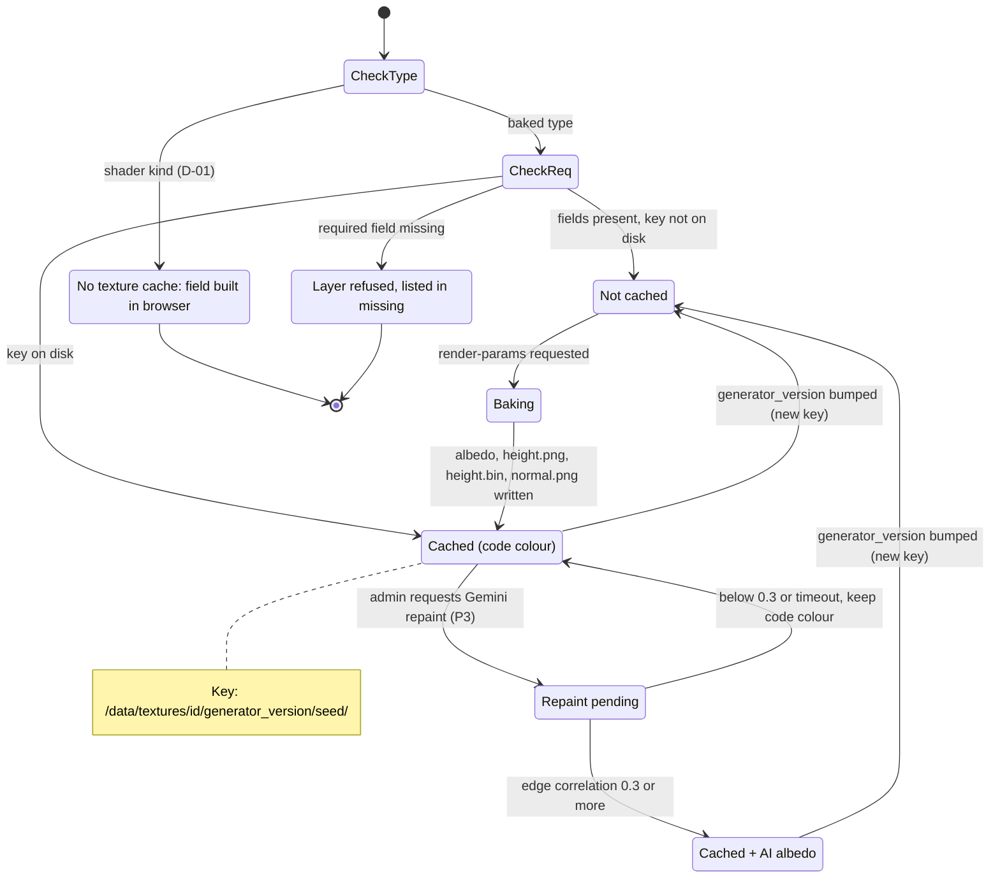

# 16 State: asset lookup and texture cache

Diagram 1 is the asset status from pipeline stage 4 (`saved`, `generated`, `sketch`). Diagram 2 is the life of one backend texture-cache entry. Drawn from architecture spec §4.4, §5.4 and §10, rendering doc §6.6–6.7, §7.7, and decisions D-01, D-02 and D-07.

## Diagram 1: asset status

## Diagram 2: texture cache entry

## Notes

- With D-02 the settings file is retired. What a `saved` asset contains now (card, RenderParams, textures) is not restated in the specs **[verify]**.
- The architecture spec put generated assets in browser IndexedDB; the backend texture cache is separate.
- Bumping `generator_version` does not delete old entries; it changes the key. Clean-up is not specified.
- Baking failures are not specified **[verify]**.
