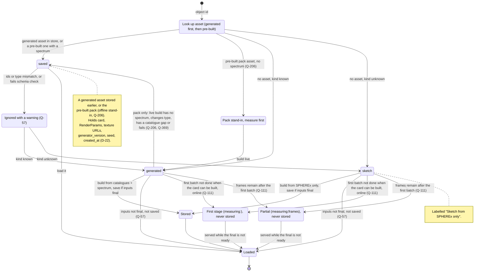
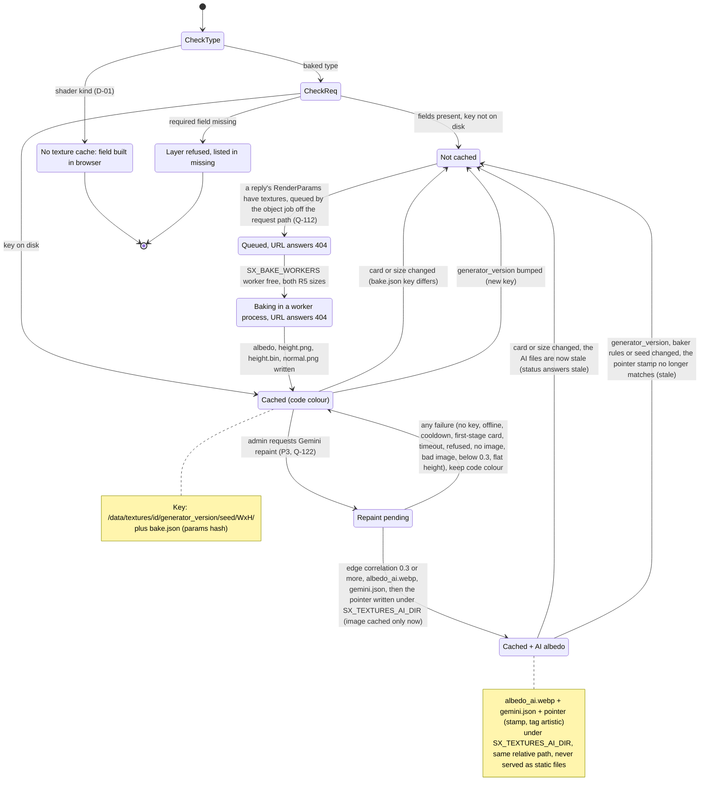

# 16 State: asset lookup and texture cache

Diagram 1 is the asset status from pipeline stage 4 (`saved`, `generated`, `sketch`). Diagram 2 is the life of one backend texture-cache entry. Drawn from architecture spec §4.4, §5.4 and §10, rendering doc §6.6–6.7, §7.7, and decisions D-01, D-02, D-07 and D-22, Q-111 and Q-112 (issue #41: intermediate answers, background bake), the open Q-122 (Gemini layer files), and Q-206 (issue #75: the pre-built pack as a stand-in), amended by Q-369 (issue #93: a live build with a catalogue gap loses to the pack).

## Diagram 1: asset status

## Diagram 2: texture cache entry

## Notes

- With D-02 the settings file is retired. A `saved` asset holds the ObjectCard, the RenderParams, the texture URLs, `generator_version`, `seed` and `created_at` (D-22, architecture spec §5.4). `generator_version` and `seed` keep the texture cache key reproducible.
- The architecture spec puts generated assets and the user's `overrides` in browser IndexedDB; `overrides` are never sent to the server (D-22). The backend texture cache is separate, and so is the read-through cache of external calls (D-25).
- Bumping `generator_version` does not delete old entries; it changes the key. Clean-up is not specified.
- Baking failures: as built (issue #41) a failed bake is logged and writes nothing, so its URL answers 404 until a later reply queues it again (`render/background.py`).
- As built (issue #14, Q-122): a Gemini repaint never leaves the entry broken. Every failure returns to `Cached` with the code colour, and the reason is in the status body (`albedo_ai` in `missing`). The AI files live under `SX_TEXTURES_AI_DIR` (default `<SX_CACHE_DIR>/textures-ai`), outside the `/data/textures` static mount (`SX_TEXTURES_DIR`, default `<SX_CACHE_DIR>/textures`). The status endpoint reports `not_painted` for `Cached`, and `stale` when the pointer's stamp (generator version, baker rules, seed, size) is not the bake the viewer shows or `gemini.json` does not match the current `bake.json`.
- As built (issue #5): a `generated` or `sketch` asset is stored only when its inputs are final (a spectrum from a complete frame list, and a catalogue match or typed coordinates); otherwise it is rebuilt on every request (Q-57). The status reaches the client as the `X-SX-Asset-Status` header (Q-39). Pre-baked assets live in `backend/assets/<type>/<id>.json` (`SX_ASSETS_DIR`); generated ones in the D-25 cache as `derived.asset`, keyed by id, data release, `ASSET_VERSION` and `GENERATOR_VERSION`. A saved or pre-baked asset whose card or params id is not the requested id, whose card and params disagree on `type`, or that fails the `jsonschema` check is ignored with a warning and rebuilt from the catalogues, never returned as an error (the Rejected state). This differs from A5.4, which puts generated assets in IndexedDB (Q-57). A saved asset whose card type is `candidate` is reported as `sketch`, not `saved`, so the "Sketch from SPHEREx only" label survives the save; a saved generated asset reports the `fetched_at` of its cache entry as `X-SX-Cached-At` (PR #34 review). Since issue #41 (Q-111) a `generated` or `sketch` asset without a saved copy comes from the object's job, which can serve a first-stage answer (catalogue only, `measuring:`) and a partial one (first batch, `measuring:frames`) before the final one; both are loaded by the client but never stored, and only the final answer goes to Stored. Since issue #75 (Q-206) the generated asset is read before the pre-built pack, and a pack asset with no spectrum (every demo row) is only a stand-in: the object is built live and the pack answers, as `saved`, only when that build has no spectrum, changes type (catalogue missing offline) or cannot run.
