# 17 Activity: pipeline stages 1–6 and RenderParams

The backend pipeline from a name or RA/Dec to an `ObjectCard` and `RenderParams`, including every refusal branch (since D-32, a refusal only where no tier can answer). Drawn from architecture spec A4.1–A4.2 ([pipeline.md](../architecture/pipeline.md)), A4.3–A4.8 ([pipeline-card.md](../architecture/pipeline-card.md)), the object job A4.10 ([jobs.md](../architecture/jobs.md#a410-object-job-and-fan-out)) and the refusal codes A4.12 ([refusals.md](../architecture/refusals.md#a412-missing-and-refusal-codes)), rendering doc R1 (principles), R3, R3.3, R5.2, R6.2, R7 and decisions D-01, D-02, D-04, D-19 and D-25. Movers (Track, A19) take the moving-object branch of stage 1, built by PR #53 (issue #26), and the Q-139 rule of stage 2 (to build, ticket T4). The old stage 5 "settings file" is replaced by the card builder (D-02).

```mermaid
flowchart TD
  Start(("Start")) --> In[/"Name or RA/Dec"/]
  In --> IsName{"Is it a name?"}
  IsName -->|yes| SmallBody{"Looks like a small body? (D-19)"}
  IsName -->|no| HaveCoord["Use RA/Dec"]
  SmallBody -->|yes| ResSBDB["SBDB first, SIMBAD on a miss"]
  SmallBody -->|no| ResSIMBAD["SIMBAD first, SBDB on a miss"]
  ResSBDB --> Resolved{"Resolved?"}
  ResSIMBAD --> Resolved
  Resolved -->|no| NotFound["Show: name not found"] --> Stop1(("Stop"))
  Resolved -->|yes| HaveCoord

  HaveCoord --> Moving{"Moving object?"}
  Moving -->|yes| Horizons["Horizons path seen from SPHEREx, SIA cones along it, keep frames whose footprint holds the path, exact position per frame midpoint (model_dependent), neighbours from SkyBoT"]
  Moving -->|no| Static["Fixed RA/Dec (proper motion for stars)"]
  Horizons --> WCS["Sky to pixel per frame via WCS"]
  Static --> WCS
  WCS --> Frames{"Any SPHEREx frames?"}
  Frames -->|no| NoCov["Show: no SPHEREx coverage"] --> Stop2(("Stop"))
  Frames -->|yes| S1Out[/"Stage 1 out: frame_id, x, y, time"/]

  S1Out --> Phot["Stage 2: aperture flux minus local background"]
  Phot --> Flags["Drop flagged pixels, mark saturated points"]
  Flags --> Err["Variance layer to error bars, wavelength from WCS-WAVE"]
  Err --> S2Out[/"Spectrum and light curve"/]

  S2Out --> Classify["Stage 3: match reference types, Gaia colours if known"]
  Classify --> TypeSel["Type selection (see diagram 18)"]
  TypeSel --> Lookup{"Stage 4: saved asset?"}
  Lookup -->|saved| LoadSaved["Load saved asset"]
  Lookup -->|"generated or sketch"| Card["Card builder: one TV per field"]

  Card --> Field{"Value available from a source?"}
  Field -->|yes| Tagged["TV with value, tag, source, formula or assumption"]
  Field -->|no| NullV["value = null, never a guess"]
  Tagged --> Physics
  Tagged -->|"comet or asteroid"| Light["Comets and asteroids: Horizons lighting, phase angle (measured) and sun_vector (derived), Q-62"]
  Light --> Physics["Stage 6: physics layer adds derived TVs with formula"]
  NullV --> Physics
  Physics --> SpxCh{"At least 2 points in each spherex_rgb channel window?"}
  SpxCh -->|yes| SpxOK["spherex_rgb measured"]
  SpxCh -->|no| SpxMiss["IR mode disabled, add to missing"]
  SpxOK --> CardOut[/"ObjectCard"/]
  SpxMiss --> CardOut
  LoadSaved --> CardOut

  CardOut --> C2P["card_to_params: rules of rendering doc 6.2, each with a tag"]
  C2P --> Layer{"For each layer: all required fields present?"}
  Layer -->|yes| AddLayer["Add layer with its tag"]
  Layer -->|no| Refuse["Refuse layer, add to missing"]
  AddLayer --> Kind{"Rendering-doc type or shader kind?"}
  Refuse --> Kind
  Kind -->|"rendering-doc type (D-01)"| Bake["Procedural maps needed: texture URLs from cache, bake if missing"]
  Kind -->|"shader kind"| NoTex["No textures, browser builds the field"]
  Bake --> RPOut[/"RenderParams"/]
  NoTex --> RPOut
  RPOut --> Done(("End"))
```

## Notes

- D-32: stage 6 and `RenderParams` fall back a tier and label it before refusing; the refusal branch above is the last rung, and `scale_m` and card values never fall back. The diagram shows the refusal branch only.
- Refusal examples: an asteroid card without `diameter_km` puts the mesh in `missing` with no crash (rendering doc §11); a comet without published `gas_Q` gets no gas shells (§7.3).
- Saturated points are excluded from brightness mapping and shown hatched (rendering doc §7.5).
- `candidate` has no 3D layers. As built (issue #5) the endpoint still returns a RenderParams for it, with `layers: []`, `scale_m: null` and `mesh` in `missing` (Q-33).
- As built (issue #5) the render-params endpoint names the R6.7 texture URLs; since issue #41 (Q-112) the bake runs in a worker process off the request path, both sizes, and `/data/textures` serves the result. Cards and render params are validated with `jsonschema` before they are sent (Q-40).
- As built (issue #41, Q-111): the stages are drawn in order, but the catalogue (stage 3 input), the Horizons lighting and stage 1 run at the same time inside one job per object, and stage 2 measures each frame as its cutout lands. If stage 2 is not done when the card can be built, a first-stage `ObjectCard` and `RenderParams` go out with the SPHEREx fields and layers marked `measuring:`; if frames remain after the first batch, a partial pair measured from it follows (`measuring:frames`), then the final pair. Only the final pair can be saved (stage 4).
- The physics layer is "reduced, physically inspired" formulas (architecture spec §7); its outputs are tagged `derived`.
- Every external call in this flow goes through the backend's read-through cache (D-25). With `SX_OFFLINE=1` a cache miss is refused, and the refused layer goes in `missing`.
- Small-body names are numbered asteroids, provisional designations, comets and interstellar objects (D-19).
- Moving objects (issue #26, A4.1): the frame search runs SIA cones along a SPHEREx-centred Horizons path; cone radius, step, cap and pacing are **[verify]** settings (Q-21). Positions and pixels are `model_dependent` (Q-125). A web request runs it from the cache only and starts the object job for the rest (Q-111). MOST as the primary search: Q-126.
- As built (issue #5): the saved-asset check runs before stage 3, as in A4.4's pseudocode, so a saved asset skips classification. Stage 3 takes the class label from the catalogue only; spectrum matching and Gaia colours are not built (Q-55). Generated assets are saved only when their inputs are final (Q-57).
