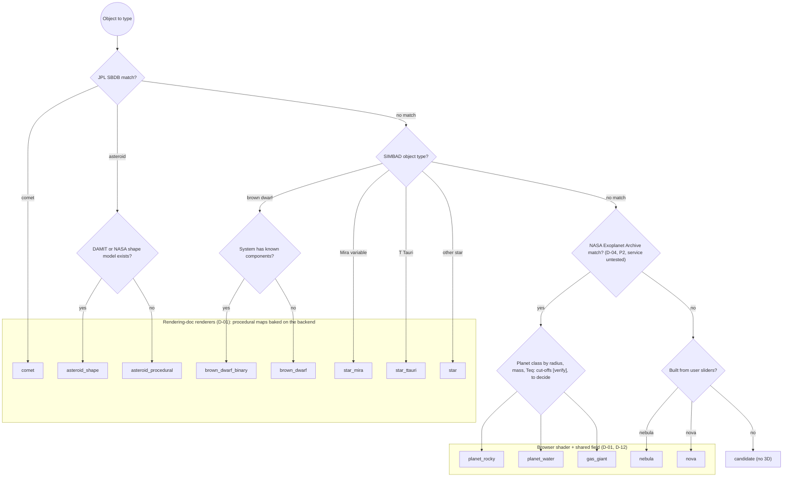

# 18 Activity: type selection

How the backend chooses the `ObjectType` that picks the renderer and haptic profile. Drawn from rendering doc §3.3 (now including the Exoplanet Archive and slider branches) and decisions D-01 and D-04. Thresholds that are not yet agreed are marked **[verify]**.

## Notes

- Q-05 open: whether SIMBAD or SBDB resolves names first. The type rules above check SBDB, then SIMBAD.
- No catalogue rule exists for `nebula` and `nova`; they come from user sliders only (rendering doc §3.3).
- For orientation only, not a type rule: brown dwarf spectral types are roughly L above ~1,400 K, T from ~1,400 K to 500 K, Y below ~500 K (architecture spec §7.3, approximate).
- The old architecture-spec kinds map as `dwarf` → `brown_dwarf` and `asteroid` → `asteroid_shape` or `asteroid_procedural` (D-04).
- Stars are self-lit and drawn from their own data (blackbody colour, limb darkening), not from the shader generators; they are grouped with the rendering-doc renderers because they follow the rendering doc, not the browser-shader path. Only types that need procedural maps (for example `asteroid_procedural`, brown dwarf bands) are baked.
