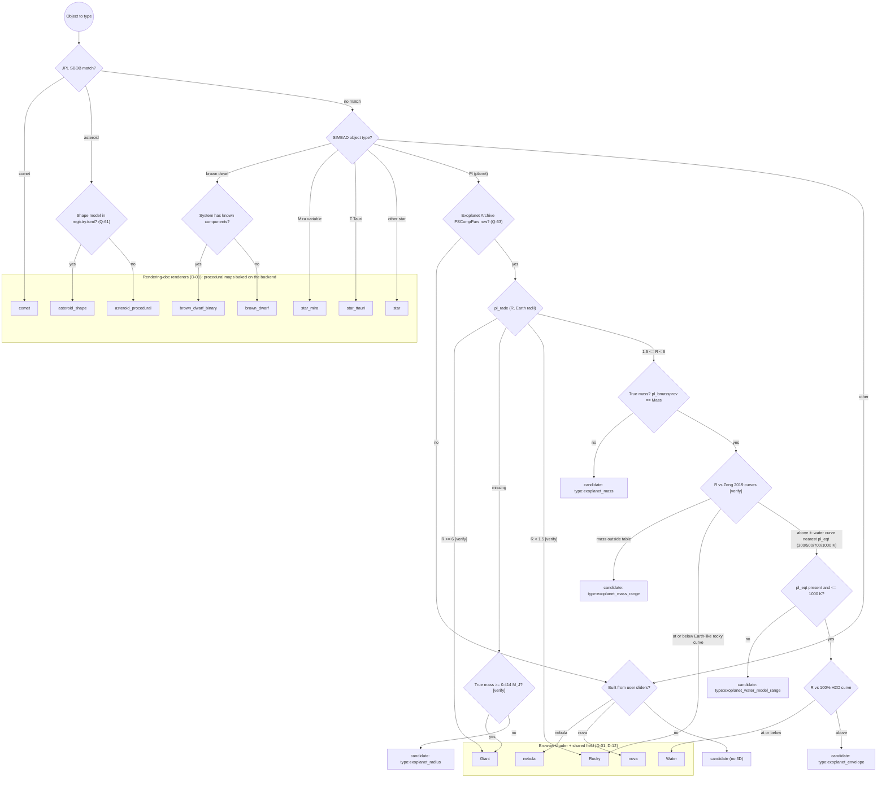

# 18 Activity: type selection

How the backend chooses the `ObjectType` that picks the renderer and haptic profile. Drawn from rendering doc §3.3 (now including the Exoplanet Archive and slider branches) and decisions D-01 and D-04. The exoplanet thresholds are on since issue #68 (Q-63, signed off by Moon); they keep their **[verify]** marks because the 1.5 and 6 R_E cuts are project cuts based on the cited papers, not published class boundaries.

## Notes

- Name resolution order is D-19: SBDB first for names that look like small bodies, SIMBAD first otherwise. The type rules above check SBDB, then SIMBAD.
- No catalogue rule exists for `nebula` and `nova`; they come from user sliders only (rendering doc §3.3).
- For orientation only, not a type rule: brown dwarf spectral types are roughly L above ~1,400 K, T from ~1,400 K to 500 K, Y below ~500 K (architecture spec §7.3, approximate).
- The old architecture-spec kinds map as `dwarf` → `brown_dwarf` and `asteroid` → `asteroid_shape` or `asteroid_procedural` (D-04).
- Stars are self-lit and drawn from their own data (blackbody colour, limb darkening), not from the shader generators; they are grouped with the rendering-doc renderers because they follow the rendering doc, not the browser-shader path. Only types that need procedural maps (for example `asteroid_procedural`, brown dwarf bands) are baked.
- As built (issue #5, `backend/app/core/classify/rules.py`, updated for issue #40): SIMBAD otypes are `BD*` (brown dwarf), `Mi*` (Mira), `TT*` (T Tauri), `Pl` (planet, not `Pl?`), and any otype ending in `*` plus `s*r`, `s*y`, `s*b`, `Y*O` (other star); "known components" means a composite spectral type with `+` (Q-55). The shape-model branch reads `backend/assets/shapes/registry.toml` (Q-61); it holds only Gaskell Eros, so every other asteroid is `asteroid_procedural`. Planets follow Q-63: the proposed thresholds live in `PROPOSED_EXOPLANET_THRESHOLDS` and the Zeng et al. 2019 tables in `zeng2019.py`, all still **[verify]**; central values only. Since issue #68 (Q-63 signed off by Moon, 9 Nov 2026) the live `EXOPLANET_THRESHOLDS` are the proposed values, so archive planets are typed; a value set back to `None` still takes the refusal path (`type:exoplanet_thresholds`). Archive values marked `CALCULATED_VALUE` count as missing. A refused planet becomes `candidate` with the reason in `missing`. The Exoplanet Archive adapter queries `pscomppars` by name through the TAP service.
