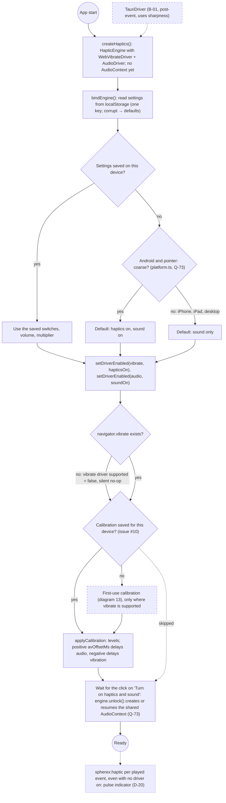

# 19 Activity: choosing haptic drivers at start-up

How the frontend decides which drivers the `HapticEngine` fans out to, and when calibration runs. Drawn from rendering doc §8.1, §8.7–8.8 and decisions D-08 (web only, no Tauri at the event), D-09 (calibration per device), D-10 (audio alongside vibration everywhere), D-20 (`sharpness`, no native or iOS bridges, `spherex:haptic` debug hook) and B-01. **At the event (Q-132)** the A15 laptop is a desktop: the platform default is sound only, `navigator.vibrate` does nothing, and calibration never runs, so the event path is AudioDriver only. The vibrate and calibration branches (dashed) apply after the event.

## Notes

- With default settings, an Android phone gets WebVibrateDriver + AudioDriver; iPhone, iPad and desktop get AudioDriver only (D-08, D-10, R8.7). An Android browser without a touch screen (desktop mode, Chromebook) starts on sound only (Q-73).
- Both drivers are always in the engine's list; the settings switches enable or disable them, and a disabled driver is stopped. The engine never runs on its own timers unless a source starts a train.
- The mock-up's `window.SphereXNative.haptic` and iOS `webkit.messageHandlers.sphereXHaptic` bridges are not checked: they are dropped for the event (D-20).
- The `spherex:haptic` debug event is fired by the engine for every event that passes the honesty gate and the rate cap, whether or not a driver is on (D-20).
- The unlock must be a `click`: it is the user activation for both `navigator.vibrate` and the AudioContext (R8.9). When the calibration wizard first runs (start-up or first entry to Touch mode) is not decided yet: it is an item of the M5 integration checklist (rendering doc [§8.8](../rendering/haptics/engine-api.md#r88-engine-api)).
- Haptics never carry information that is not also available as text or sound (rendering doc §9), so sound-only or no output loses no content.
