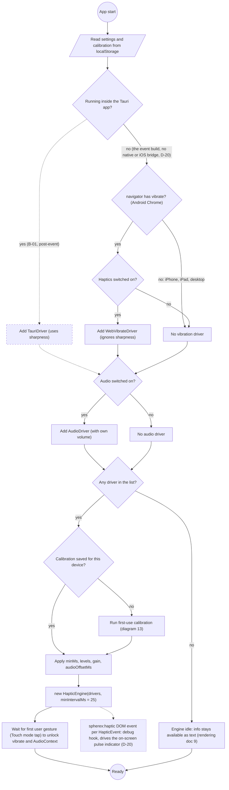

# 19 Activity: choosing haptic drivers at start-up

How the frontend decides which drivers the `HapticEngine` fans out to, and when calibration runs. Drawn from rendering doc §8.1, §8.7–8.8 and decisions D-08 (web only, no Tauri at the event), D-09 (calibration per device), D-10 (audio alongside vibration everywhere), D-20 (`sharpness`, no native or iOS bridges, `spherex:haptic` debug hook) and B-01.

## Notes

- With default settings, Android Chrome gets WebVibrateDriver + AudioDriver; iPhone, iPad and desktop get AudioDriver only (D-08, D-10).
- The mock-up's `window.SphereXNative.haptic` and iOS `webkit.messageHandlers.sphereXHaptic` bridges are not checked: they are dropped for the event (D-20). The optional `sharpness` is ignored by the web driver and used by a future Tauri driver (B-01).
- The `spherex:haptic` debug event and its on-screen pulse indicator are drawn from the engine, as in diagrams 06 and 11. Which module fires it, and whether it fires when no driver is active, is not stated.
- When calibration runs (at start-up or on first entry to Touch mode) is not fixed by the spec; "first use" is all it says **[verify]**.
- Haptics never carry information that is not also available as text or sound (rendering doc §9), so "Engine idle" loses no content.
