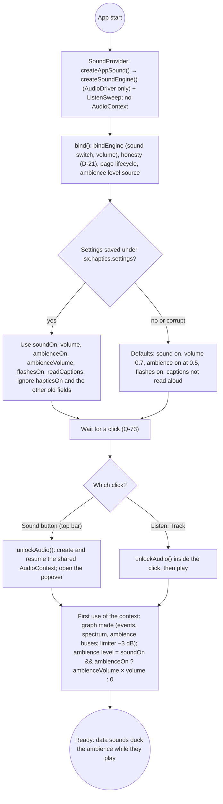

# 19 Activity: sound start-up

> **D-39 (12 Nov 2026):** this file used to show how the haptic engine chose its drivers (vibrate, audio) and when calibration ran. Haptics are cut. The sound engine has one driver, the audio driver, so there is nothing to choose. The file name is kept so links stay valid.

How the app's sound comes up (R8.8, R13.9, Q-73, Q-132): nothing sounds and no AudioContext exists until a click.

