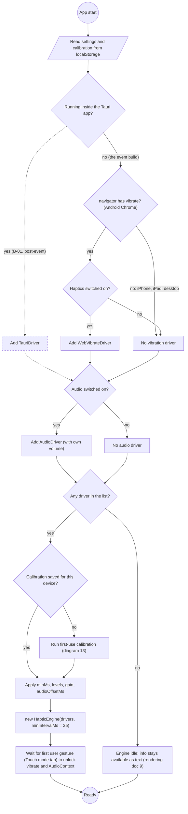

# 19 Activity: choosing haptic drivers at start-up

How the frontend decides which drivers the `HapticEngine` fans out to, and when calibration runs. Drawn from rendering doc §8.1, §8.7–8.8 and decisions D-08 (web only, no Tauri at the event), D-09 (calibration per device), D-10 (audio alongside vibration everywhere) and B-01.

## Notes

- With default settings, Android Chrome gets WebVibrateDriver + AudioDriver; iPhone, iPad and desktop get AudioDriver only (D-08, D-10).
- When calibration runs (at start-up or on first entry to Touch mode) is not fixed by the spec; "first use" is all it says **[verify]**.
- Haptics never carry information that is not also available as text or sound (rendering doc §9), so "Engine idle" loses no content.
