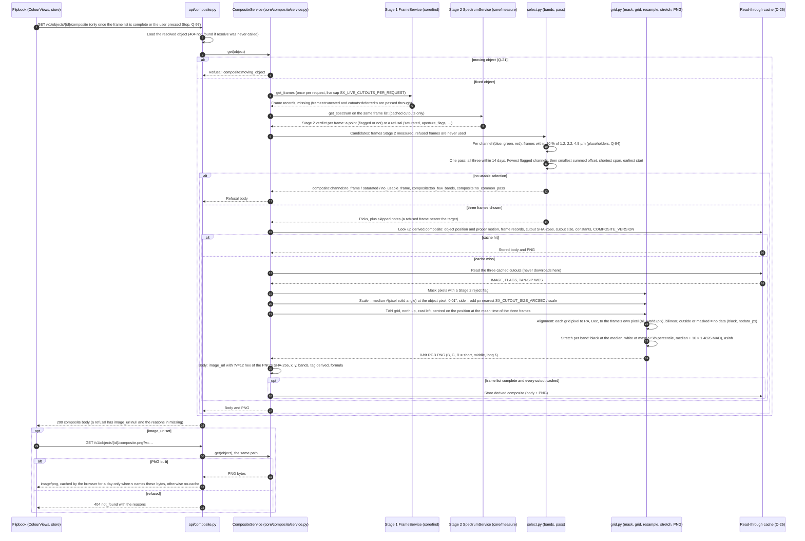

# 20 Sequence: SPHEREx colour composite

How the backend answers `GET /v1/objects/{id}/composite` and `/composite.png` (sky-view prototype, beyond D-16): band selection, alignment on one grid, stretch and the derived cache. The flipbook side (Raw ↔ Colour toggle, `colour=` link parameter) is in [08](08-sequence-search-flipbook.md). Drawn from architecture spec §4.1 and §4.2, the [backend README](../../backend/README.md#composite) and decisions D-25 (cache), Q-21 (moving objects), Q-27 and Q-93 (tags), Q-92 (endpoints), Q-94 (constants) and Q-97 (progressive frames).

## Notes

- The composite is false colour, tagged `derived` with the reply's `formula` (Q-27, Q-93). In "Measured only" (D-21) the flipbook does not request it and shows the grey frames with a note ([08](08-sequence-search-flipbook.md)).
- The endpoints are not in D-16 yet; Q-92 proposes adding them. The band targets, pass length and stretch are placeholders (Q-94, a creative call for Atish).
- Stage 1 runs once per request, so a live backend downloads at most `SX_LIVE_CUTOUTS_PER_REQUEST` cutouts here as well (Q-97, Q-99). The composite itself reads only cutouts that are already cached.
- `scripts.prefetch` builds the composite for every non-moving target after it fills the frame list, so it is in the cache for `SX_OFFLINE=1` (D-25). A refusal is an answer, not a failure.
- Further refusals and notes (`composite:<channel>:stretch`, `composite:pixel_scale`, `cutout:<id>`, `composite:no_proper_motion`, `composite:flags_unmasked:<id>`) are listed in the [backend README](../../backend/README.md#composite).
