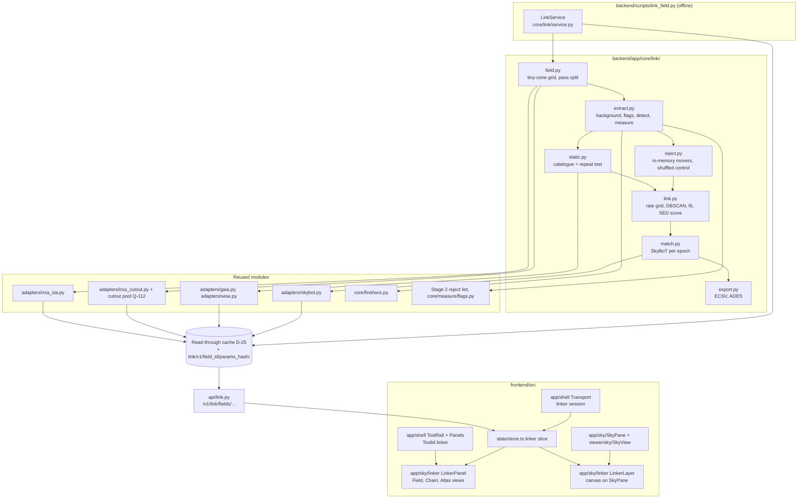
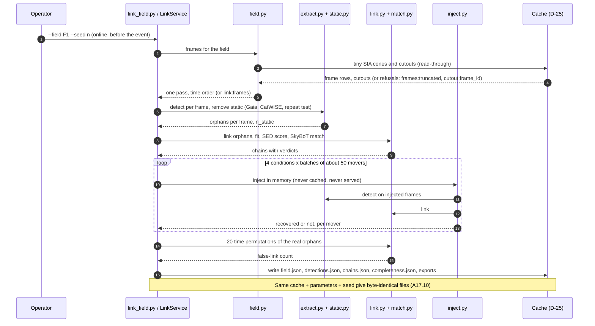
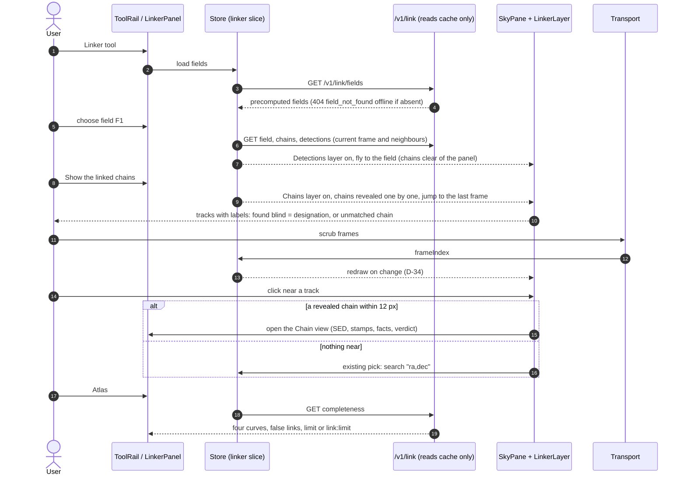

# 21 Band-Hop Linker: components and sequences

The Band-Hop Linker of [A16](../architecture/linker.md) (proposal, Q-113): the offline field pipeline, the cached results, the `/v1/link` routes, and how the sky view draws them as layers. Three diagrams: components, the offline precompute, and the sky interaction. Drawn 8 Nov 2026 from the spec; nothing here is built yet.

## Components

## Offline precompute

## In the sky view

