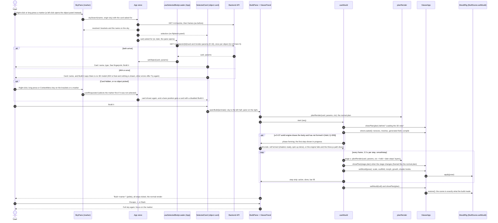

# 21 Sequence: select a body and Build it

A left click on a marker opens the object panel (Q-120); a right-click or long press selects it and asks for the card; *Build it* opens the split view and moulds the body through the mock-up's steps from the real plan. Drawn from issue #60, Q-113 and Q-120 (decisions), [R5.8](../rendering/build-mould.md#r58-build-split-view-and-moulding) (the rules of the build pane), the shell's split pane ([A21.8](../architecture/sky-shell-behaviour.md#a218-split-pane)), R5.3, R5.7 and R9, decisions D-16, D-21 and D-34, and the mock-up (`showInfo`, `openBuild`, `PLAN`, `loop`). Shell states: [24-state-shell.md](24-state-shell.md).

## Notes

- Reduced motion (R9): no stages; the normal plan is shown at once and every step is ticked.
- Engine hold (issue #93, Q-339): while a D-37 world engine compiles and forms the world, `useMould` is in the phase `'forming'`; the steps play from the start once the engine reports `onFormed`. The engine's own lifecycle and watchdog are in [R5.9](../rendering/engines.md#r59-prototype-engines-d-37) and diagram [10](10-sequence-view-3d.md).
- The body loads in `useSelectedBodyLoader` (`app/build/selectedBody.ts`, called from `App.tsx`) when the card is asked for or the pane opens, not on every marker click (Q-120 item 5). SelectedCard only shows it.
- Feel (R5.6) takes effect once the body is built; during the moulding a drag turns the body (R5.8). Raising the honesty level automatically while moulding (Q-113 item 7) is proposed, not built.
- The rail's 3D viewer opens the same pane with `animate` false: the normal plan at once.
- A stage never draws a layer the normal plan does not draw (`mouldSteps.test.ts`); the base mould of a type whose shape is a layer is the plain body at the size on the card.
- The body's turn while building (mock-up auto-rotation and drag) is a view state like the camera: R or Reset view returns it to the normal pose.
