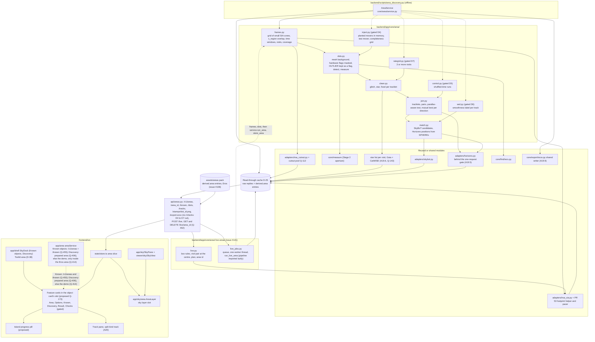
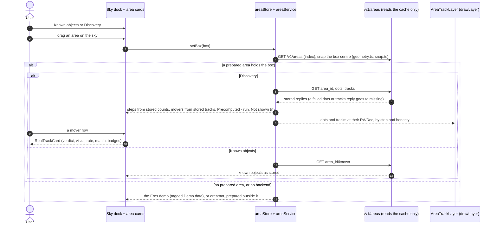
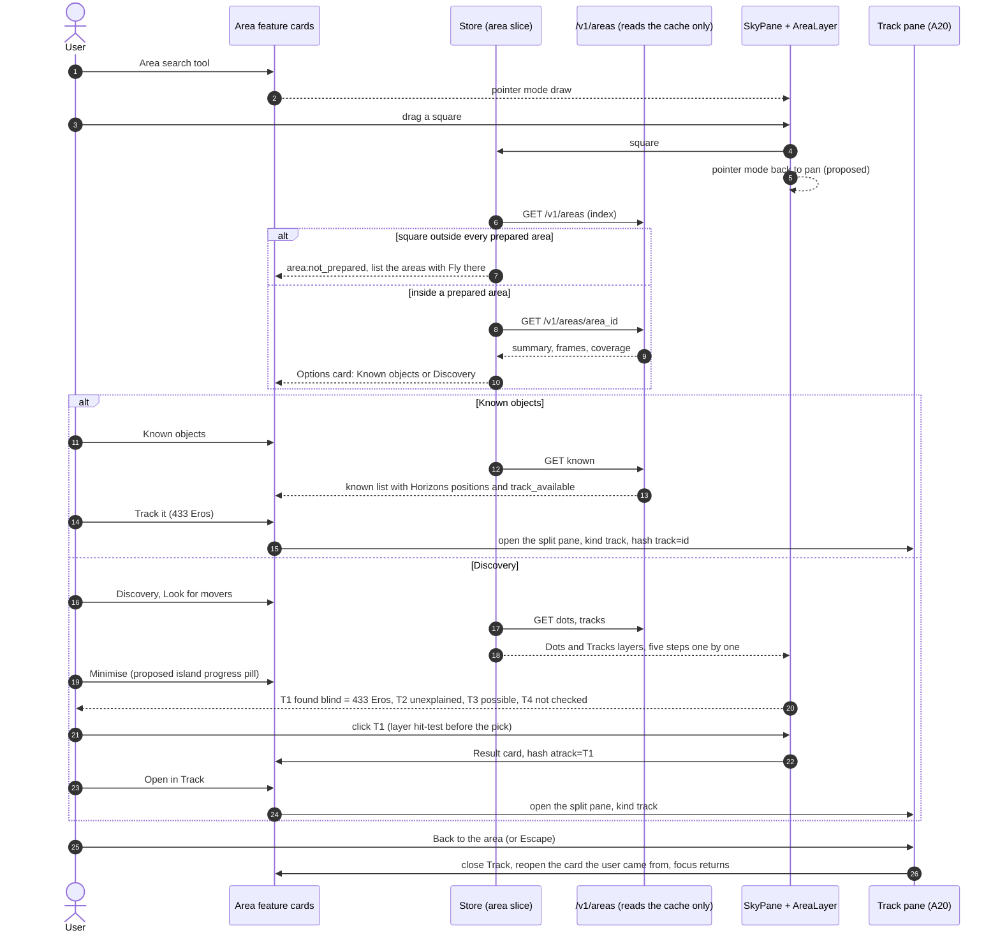
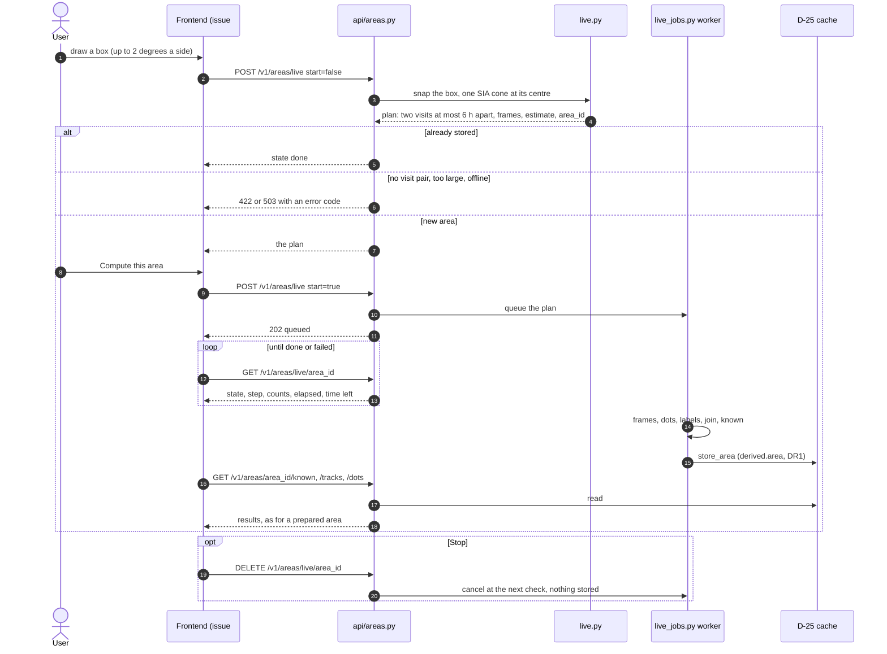
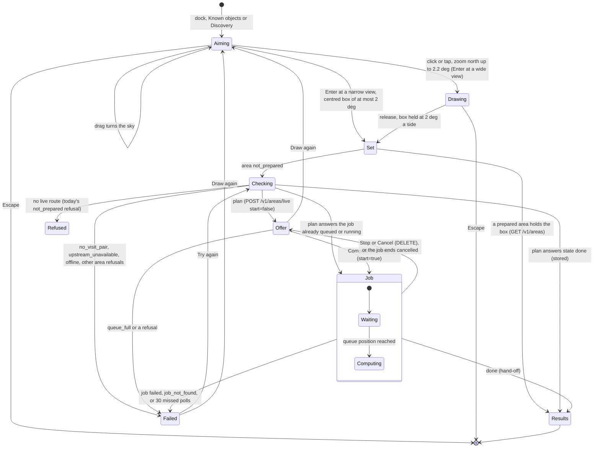

# 22 Area search: components and sequences

Area search of [A16](../architecture/moving-objects/area-search.md) (agreed plan, Q-146): a square drawn on the sky, then **Known objects** (hand-off to Track, [A19](../architecture/moving-objects/track.md) and [A20](../architecture/moving-objects/track-ui.md)) or **Discovery** (dots, glitches, stars and fixed dots removed, joined across visits with a parallax-aware test, checked against known objects). Three diagrams: components, the offline precompute, and the sky interaction. Drawn 9 Nov 2026 from A16 to A18 (backend [A17](../architecture/moving-objects/area-backend.md), sky UI [A18](../architecture/moving-objects/area-ui.md), shell [A21](../architecture/sky-shell.md)). **Built:** the backend from frames to the API (issues #97 and #108: `frames.py`, `dots.py`, `clean.py`, `join.py`, `match.py`, `service.py`, `api/areas.py`, `core/export/ecsv.py`) and the committed Eros pack. The frontend reads `/v1/areas` from the sky dock (issue #96, Q-406): a prepared area that holds the drawn box answers first, and the Q-414 demo only where none does. Known objects' rows carry their Horizons positions and **Track it** reads the object's `/frames` and `/path` for the Eros card (issue #130, Q-455). **Live areas (issue #141, Q-462, Q-463):** a box drawn anywhere is planned by `core/area/live.py` and computed by a background job in `core/area/live_jobs.py` (the same pipeline, stored as `derived.area`), on SPHEREx DR1; see the live area job sequence. **Scans and runs (issue #156, Q-470, Q-471):** a region scanned square by square on the same worker, every run recorded with a replay timeline; see the scan and run sequence. The frontend's aim, draw and live card (issue #144) is the last diagram. Not built: the gated extras D4 to D7 (cut). Items marked "proposed" wait on a decision (Q-178 to Q-187 in the spec).

## Components



`join.py` asks Horizons for SPHEREx's velocity relative to the geocentre, one vector per visit, for the parallax-aware test (A17.4; built in issue #108, `horizons.spherex_velocity`).

## Offline precompute

```mermaid
sequenceDiagram
  autonumber
  participant Op as Operator
  participant S as area_discovery.py / AreaService
  participant F as frames.py
  participant D as dots.py + clean.py
  participant J as join.py
  participant M as match.py
  participant C as Cache (D-25)
  Op->>S: --area eros-2026-03 (online, before the event)
  S->>F: frames for the area
  F->>C: grid of small SIA cones, then cutouts (read-through)
  C-->>F: frame rows and cutouts, or frames:cone_maxrec, no_footprint, cutout codes
  F-->>S: frames in the time windows, visits, coverage (or area:visits)
  alt run incomplete (cone_failed, cutout_failed, MAXREC, no usable cutout, no dots)
    S-->>Op: exit 1, nothing stored (the index has no area; the dock keeps the tagged demo, Q-406)
  end
  S->>D: dots per frame, then glitch, star and fixed labels
  D->>C: Gaia and CatWISE cones per visit (shared star list)
  D-->>S: movers-to-be per visit, step counts
  S->>J: tracklets, candidate pairs
  J->>C: Horizons vector of SPHEREx per visit
  J-->>S: tracks and possibles (ambiguous, no_partner, one_visit)
  S->>M: check the tracks
  M->>C: SkyBoT cone per visit (candidates only)
  M->>C: Horizons TLIST per candidate at every frame time, one request at a time
  M-->>S: verdicts found_blind, unexplained, unchecked, and the Known list
  opt gated extras D4 to D7 (Q-203)
    S->>D: planted movers in memory (test mover, completeness grid)
    S->>J: shuffled-time runs, rate grid when 3 or more visits, spectrum score
    J-->>S: checks (planted and control results never enter tracks)
  end
  S->>C: pre-fetch Track for every Known object (or list it as skipped), not built: waits on T1
  S->>C: write derived.area entries (summary, known, dots, tracks, export, stamps as raw pixels made from the cutouts, PNG encoded when served), then the head naming the run's settings
  Note over Op,S: --recorded --pack assets/areas makes the committed Eros pack from the recorded fixtures (issue #108)
  Note over S,C: Same cache + settings give byte-identical entries (A17.10)
```

## In the sky view

> **As built (PR #104, Q-414; issue #96, Q-406):** the tool is started from the sky dock's Known objects or Discovery, so there is no Options card. The first diagram is the built flow; the second is the remaining plan (Options card, Fly there, Track hand-off, Result card hash), not built.



Planned flow with the full A18 cards:



## Live area job

> **As built (issue #141, [Q-462](../decisions/moving-objects.md), Q-463, Q-467):** a box with no prepared area is computed on request. The request only plans (one SIA cone at the box centre); the job runs in a worker thread, one at a time, and its result is served by the same routes as a prepared area. The UI for it is issues #144 and #145.



## Scan and run (issue #156)

> **As built (issue #156, [Q-470](../decisions/moving-objects.md), Q-471):** a region of up to 12° a side is cut into equal squares of at most 2° that cover it with overlap (`core/area/scan.py`), each a live area. The scan is one job on the same worker; every square is saved as it finishes, and the run is recorded with its timeline (`core/area/runs.py`, `<SX_CACHE_DIR>/runs/<run_id>.json`). A single live area started with `kind` is a run of one square. The UI is #157 (scan) and #158 (runs and replay).

```mermaid
sequenceDiagram
  autonumber
  actor U as User
  participant F as Frontend (issues #157, #158)
  participant A as api/runs.py
  participant J as live_jobs.py worker
  participant R as runs/run_id.json
  participant C as D-25 cache
  U->>F: select a region (up to 12 degrees, 36 squares)
  F->>A: POST /v1/scans start=false
  A-->>F: plan: cols, rows, squares in order, stored area ids, estimate (no SIA call)
  U->>F: Scan
  F->>A: POST /v1/scans start=true
  A->>R: create the run (queued)
  A->>J: queue the scan (one slot)
  A-->>F: 202 the run
  loop each square, top row first, left to right
    J->>R: square_started
    alt stored area found by the plan
      J->>C: read the stored replies (no SIA call)
      J->>R: square_done, found events, totals
    else no visit pair
      J->>R: square_skipped (area:no_visit_pair)
    else already stored
      J->>C: read the stored replies
      J->>R: square_done, found events, totals
    else run it
      J->>J: frames, dots, labels, join, known
      J->>C: store_area
      J->>R: square_done, found events, totals
    else any other failure
      J->>R: square_failed with its code, go on
    end
    opt Pause (after this square)
      J->>R: run_paused, the scan leaves the worker
      F->>A: POST /v1/runs/run_id/resume
      A->>J: queued again at the back (run_resumed; 429 when full)
    end
  end
  J->>R: run_done
  F->>A: GET /v1/runs/run_id (record, events), /results (merged)
  A->>R: read
  A->>C: read the finished squares
  A-->>F: the run, its timeline for replay, merged results
  opt Stop
    F->>A: DELETE /v1/runs/run_id
    A->>J: stop at the next check; finished squares stay stored (run_stopped)
  end
```

## Aim, draw and the live card (issue #144)

The frontend side of a live area, as built ([A18.1](../architecture/moving-objects/area-ui.md#a181-tool-and-drawing), Q-462): `areaStore` stages `aiming`, `drawing` and `set`, then the live card of `liveJobStore` for a box no prepared area holds. The job API is `app/area/liveAreaApi.ts` on the schemas of the sequence above. Closing the card leaves the job running (it is followed until done, failed or stopped); a done job opens in the existing Known and Discovery views.


