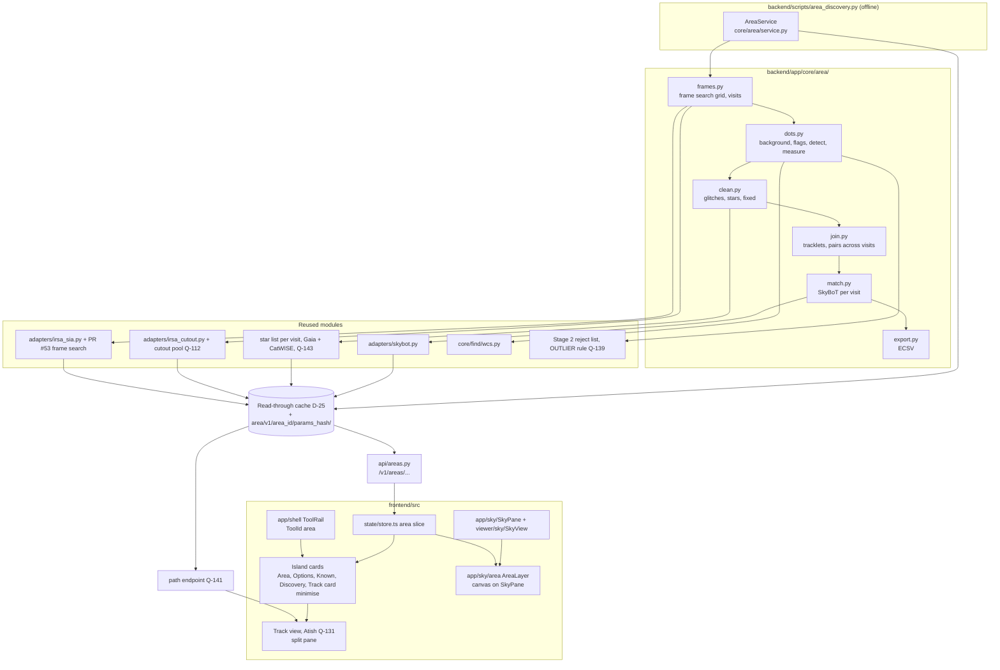
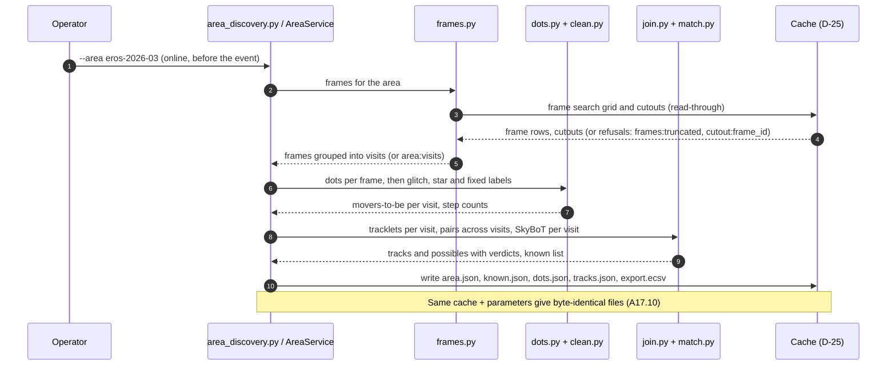
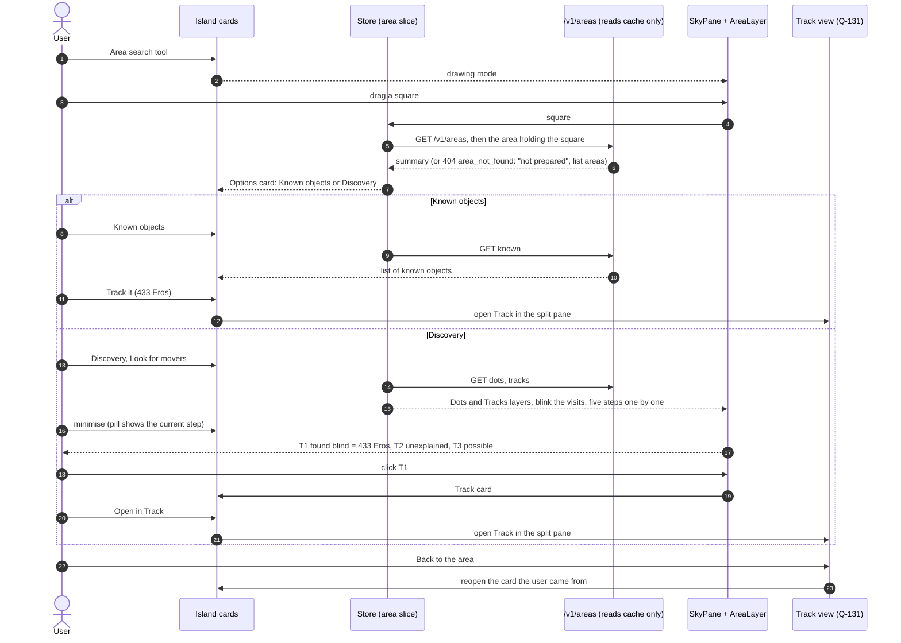

# 22 Area search: components and sequences

Area search of [A16](../architecture/moving-objects/area-search.md) (agreed plan, Q-146): a square drawn on the sky, then **Known objects** (hand-off to Atish's Track, Q-131) or **Discovery** (dots, glitches and stars removed, joined across visits, checked with SkyBoT). Three diagrams: components, the offline precompute, and the sky interaction. Drawn 9 Nov 2026 from the spec; nothing here is built yet.

## Components

## Offline precompute

## In the sky view

