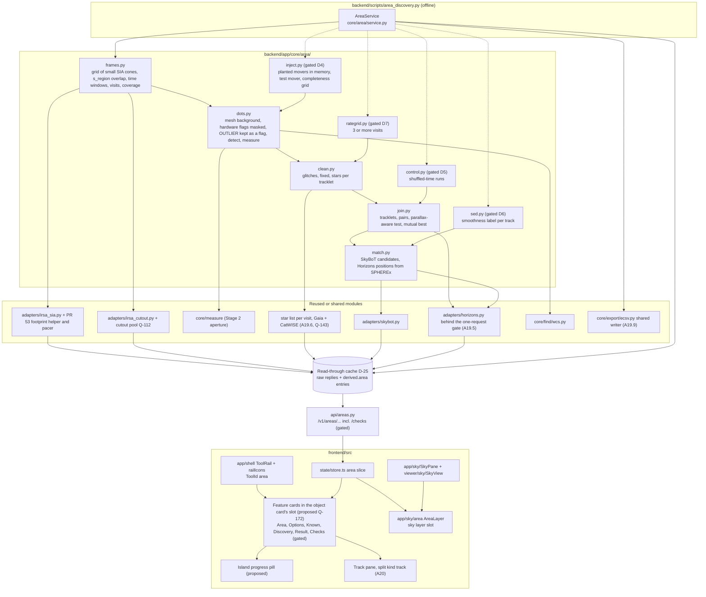
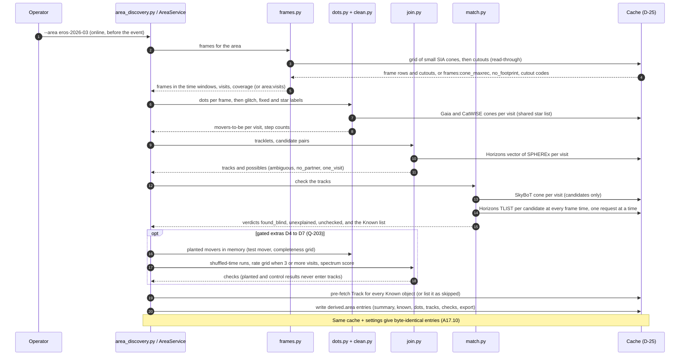
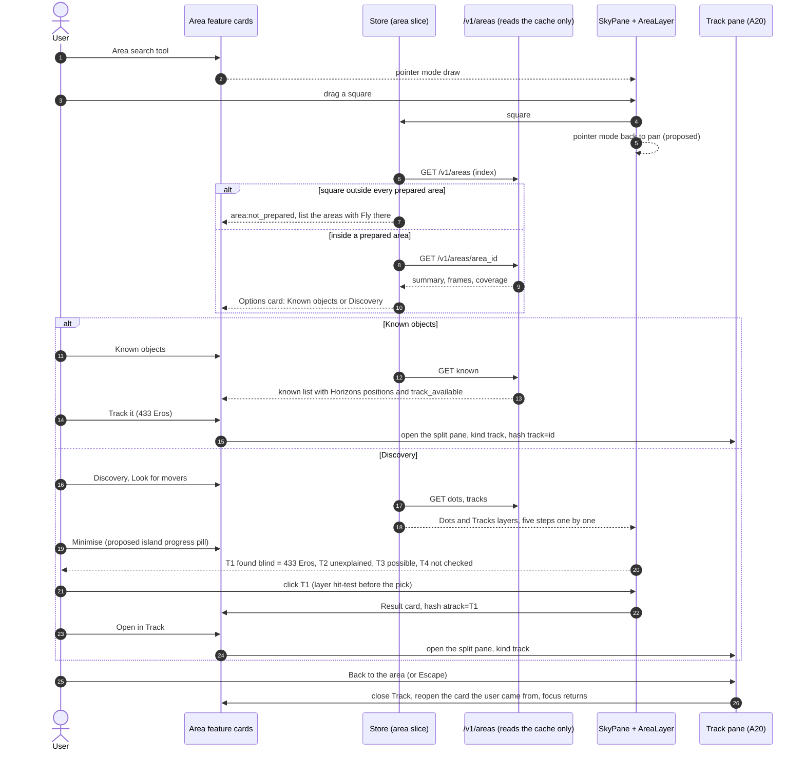

# 22 Area search: components and sequences

Area search of [A16](../architecture/moving-objects/area-search.md) (agreed plan, Q-146): a square drawn on the sky, then **Known objects** (hand-off to Track, [A19](../architecture/moving-objects/track.md) and [A20](../architecture/moving-objects/track-ui.md)) or **Discovery** (dots, glitches, stars and fixed dots removed, joined across visits with a parallax-aware test, checked against known objects). Three diagrams: components, the offline precompute, and the sky interaction. Drawn 9 Nov 2026 from A16 to A18 (backend [A17](../architecture/moving-objects/area-backend.md), sky UI [A18](../architecture/moving-objects/area-ui.md), shell [A21](../architecture/sky-shell.md)); nothing here is built yet. Items marked "proposed" wait on a decision (Q-178 to Q-187 in the spec).

## Components

`join.py` asks Horizons for SPHEREx's velocity relative to the geocentre, one vector per visit, for the parallax-aware test (A17.4, proposed).

## Offline precompute

## In the sky view

