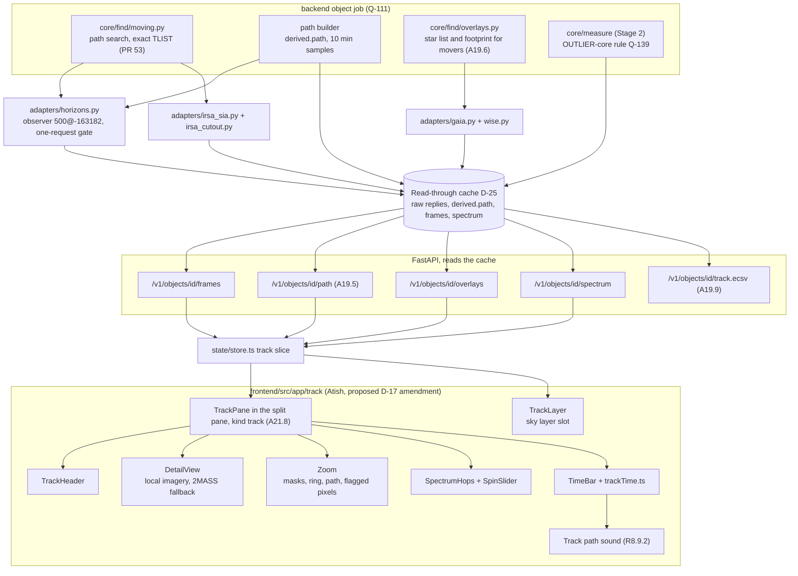
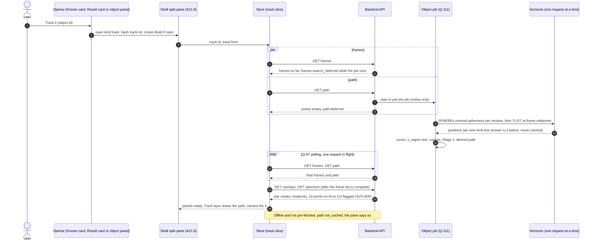
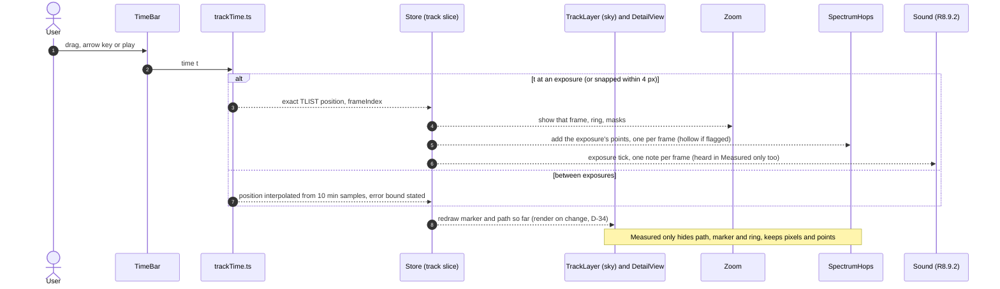

# 23 Track: components and sequences

Track of [A19](../architecture/moving-objects/track.md) (data and backend, with [A19.9 to A19.15](../architecture/moving-objects/track-contract.md)) and [A20](../architecture/moving-objects/track-ui.md) (the screen): one known solar-system object, its path seen from SPHEREx, the SPHEREx frames that caught it, a north-up zoom with stars masked and a spectrum built exposure by exposure (Q-131, Q-134 to Q-145). Three diagrams: components, opening Track (with the object job filling the path), and moving the time slider. Drawn 9 Nov 2026 from the spec; PR #53 builds the frame search, everything else is to build. Items marked "proposed" wait on a decision (Q-158 to Q-167 in the spec).

## Components

## Opening Track

## Moving the time slider

