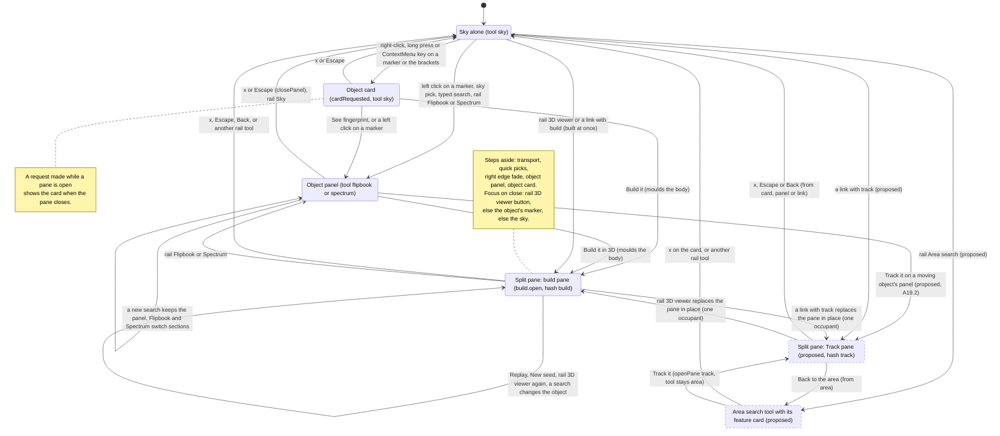
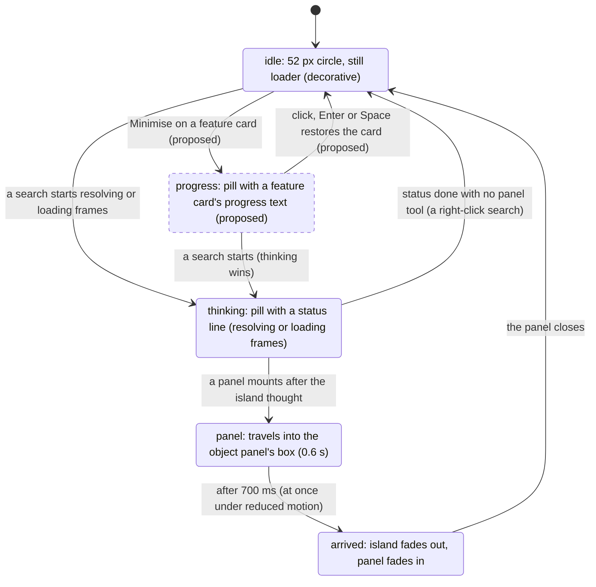

# 24 State: app shell surfaces and the split pane

Which shell surface shows, and how the user moves between them: the object panel, the object card, the build pane in the split pane, the island, and the proposed Track pane and feature cards. Drawn from [A21.4](../architecture/sky-shell.md#a214-tool-rail-and-toolid) (shell states as built, `setTool`, what a search does), [A21.5](../architecture/sky-shell-surfaces.md#a215-overlay-surfaces-island-object-panel-object-card) (island modes, object panel, object card, feature cards), [A21.6](../architecture/sky-shell-surfaces.md#a216-sky-interaction) (left click, right-click), [A21.8](../architecture/sky-shell-behaviour.md#a218-split-pane) (ways in and out, pane kinds), [A21.10](../architecture/sky-shell-behaviour.md#a2110-keyboard-and-escape) (Escape) and [A21.11](../architecture/sky-shell-behaviour.md#a2111-url-hash-and-history) (hash), and decisions Q-89, Q-113, Q-120, Q-121, Q-123 and Q-124. The names are those of the A21 Names table.

**Dashed states and the notes marked "proposed" are not decided and not built** (the pane kinds, the Track pane, the Area search tool, its feature cards and the island's `progress` mode; A21.5, A21.8, A21.11, A20.1, A18.4). Everything else is as built on main.

## Diagram 1: surfaces (tool, card request, pane)

Invariant (A21.4): at most one of object panel, object card and a pane shows; an open pane implies `tool` is `sky` or `viewer`.

## Diagram 2: the island

The island at the top centre (A21.5, Q-121, Q-123). `thinking` wins over `progress`, which wins over `idle` (proposed precedence, A21.5).

## Notes

- **Left click vs right-click** (Q-120): a left click on a marker drops the card request and searches the name, so the object panel opens; a right-click, long press or the ContextMenu key asks for the object card. A search with the build pane open changes nothing but the object under the pane (A21.4).
- **Hash** (A21.11): the build pane writes `build` (pushed with the `sxBuild` mark; Back closes it). Proposed: `track=<object id>` for the Track pane with an `{ sxPane }` mark, and `area=` / `atrack=` for Area search; only one pane key is ever written.
- **Escape** (A21.10): as built each surface has its own handler; one Escape owner with a fixed order (pane first) is proposed.
- **Pane kinds** (A21.8, proposed): `pane: null | build | track` with `from` deciding the focus return; the Track pane width is still to decide (the mock-up uses 62 %).
- The sky stays live in the left half while a pane is open. At phone width (A21.3) a pane is a full-height sheet and the island is hidden.
- The 3D view's own states (building, default, Feel, Touch) are in [15-state-interaction.md](15-state-interaction.md); the Build sequence is [21-sequence-build-mould.md](21-sequence-build-mould.md); Track and Area search sequences are [23-track.md](23-track.md) and [22-area-search.md](22-area-search.md).
