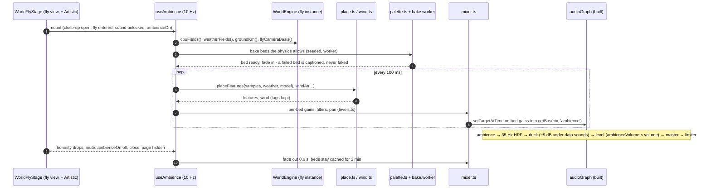

# 25 Sequence: the ambience tick (planned)

The flyover soundscape's live loop as R13.8 and R13.10 specify it ([R13](../rendering/sound/overview.md)). Planned for tickets #112 to #117. Only the audio graph at the end (`getBus('ambience')`, the duck, the level) is built (issue #111). Decisions: Q-431 to Q-442 in [sound-ambience.md](../decisions/sound-ambience.md).

